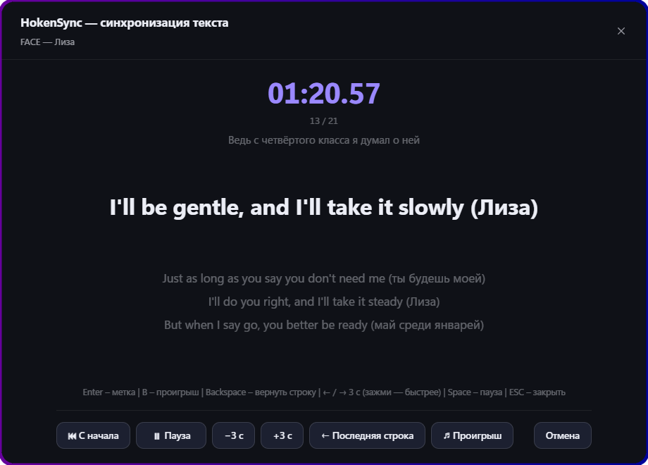
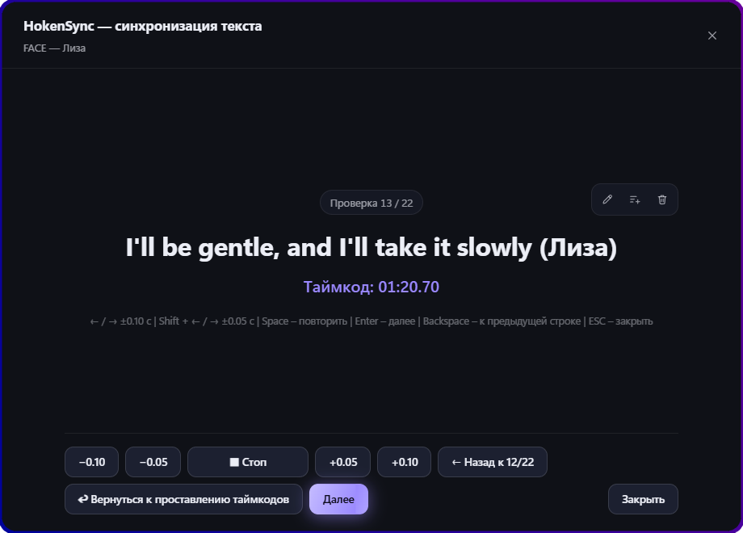

  

---

## Музыка должна быть с текстом

**HokenSync** — аддон для **PulseSync**, который помогает находить тексты песен и добавлять их к трекам так, будто текст изначально поддерживался плеером Яндекс Музыки.

Не нашёл подходящую версию? Найди текст через встроенный поиск, выбери совпадение и при необходимости отредактируй его. А если готового текста нет — создай свой и расставь таймкоды в понятном редакторе.

## Возможности

| | Возможность | Что это даёт |
|:--:|---|---|
| 🔎 | **Поиск текстов в интернете** | Ищи текст песни по названию, исполнителю и дополнительным данным. |
| 🧩 | **Дополнительные проверки совпадений** | Поиск учитывает больше данных, чтобы находить тексты даже для каверов и нестандартных версий треков. |
| ✍️ | **Ручное добавление текста** | Напиши собственный текст, если готового варианта нет или он не подходит. |
| 📄 | **Импорт из файла** | Загрузи готовый `.lrc` с таймкодами или `.txt` с текстом — кнопкой или просто перетащив файл в поле. |
| 🎵 | **Тексты для пользовательских треков** | Добавляй текст к песням, которые ты сам добавил в музыкальную библиотеку, — не только к трекам из каталога. |
| ⏱️ | **Редактор таймкодов** | Расставляй и корректируй время строк в удобном и понятном интерфейсе. |
| 🎛️ | **Редактирование найденного текста** | Подправь найденную версию под конкретную запись, кавер или исполнение. |
| ✨ | **Современный интерфейс** | Аккуратный UI и удобное управление синхронизацией текста. |
| 🎼 | **Интеграция с плеером** | Текст отображается в стилистике встроенной лирики Яндекс Музыки. |

## Интерфейс синхронизации

В режиме синхронизации виден текущий таймер, активная строка и соседние строки. Можно начать с начала, поставить паузу, перейти на несколько секунд назад или вперёд, вернуться к предыдущей строке и отметить проигрыш.

  

## Точная настройка таймкодов

Для каждой строки можно точно подобрать время появления: шагами по 0,05 или 0,10 секунды, остановить воспроизведение, повторить строку или перейти дальше. Это помогает довести синхронизацию до нужного момента песни.

  

## Найти. Добавить. Синхронизировать.

1. **Открой трек** в музыкальном плеере.
2. **Найди готовый текст** через поиск и выбери наиболее подходящий вариант — в том числе для кавера.
3. **Проверь и отредактируй** найденный текст или введи собственный.
4. **Расставь таймкоды**, чтобы строки отображались в нужный момент песни.
5. При необходимости добавь текст к **пользовательскому треку**, который сам добавил в свою библиотеку.

> Для работы некоторых функций может потребоваться **VPN или прокси**. Ряд сайтов недоступен в РФ из‑за ограничений на инфраструктуру Cloudflare. Вследствие этого отдельные функции аддона, требующие обращения к этим сайтам, могут быть неработоспособны.

## Установка

1. Установи [PulseSync](https://pulsesync.dev/), если он ещё не установлен.
2. Открой каталог аддонов PulseSync и найди **HokenSync**.
3. Установи и включи аддон.
4. Открой трек и воспользуйся поиском текста или ручным редактором.

## Решение проблем

  
<strong>Поиск не находит текст или выдаёт ошибку</strong>

  Некоторые внешние источники могут блокировать запросы через Cloudflare. Попробуй включить VPN или настроить прокси, затем повтори поиск.

  
<strong>Не находится текст для кавера</strong>

  Дополнительные проверки помогают находить подходящие тексты для каверов, но совпадение не гарантируется для каждой песни. Проверь похожие варианты в результатах и при необходимости отредактируй найденный текст вручную.

  
<strong>У песни нет готового текста</strong>

  Добавь текст самостоятельно и расставь таймкоды в редакторе.

  
<strong>Можно ли добавить текст к своей песне?</strong>

  Да. HokenSync поддерживает добавление текста к пользовательским трекам, которые ты сам добавил в музыкальную библиотеку.

  
<strong>Конфликт с PulseSync или другим аддоном</strong>

  Открой консоль (Ctrl+Shift+I) и введи `hokenDisable()` — HokenSync сразу перестанет перехватывать запросы и не запустится при следующем старте. Перезапусти приложение и проверь, ушла ли проблема. Включить обратно: `hokenEnable()`. Тексты и черновики при этом не удаляются.

  Для отчёта об ошибке включи подробный журнал: `localStorage.setItem('hokensync.debug', '1')`, повтори проблему и приложи вывод `hokenHealth()` и консоли.

## Совместимость и безопасность

HokenSync работает только внутри окна Яндекс Музыки в PulseSync: у него нет доступа к файлам, процессам и настройкам системы, он ничего не устанавливает и не запускает. Что именно он делает:

- **Сеть.** Оборачивает `fetch` и меняет ответы только на запросы текста (`api.music.yandex.net/tracks/…/lyrics` и `lrclib.net/api/get|search`). Все остальные запросы — в том числе запросы других аддонов — проходят без изменений. Если запрос уже ушёл в сеть, ошибка возвращается как есть, повторно запрос не отправляется. Сам аддон обращается только к `lrclib.net` (поиск и публикация — только по твоей команде).
- **Кэш PulseSync.** Чтобы новый текст появился без смены трека, аддон только на время одного синхронного вызова подменяет `Map.prototype.get` и сразу возвращает его обратно. `hokenHealth()` покажет, если после обновления PulseSync это перестанет работать.
- **Данные.** Тексты и настройки хранятся локально (localStorage и IndexedDB) под ключами `hokensync.*`. Чужие данные аддон не читает и не меняет.
- **Интерфейс.** Все стили и анимации с префиксом `hokensync`/`hs`, поэтому они не задевают оформление плеера и других аддонов. Горячие клавиши перехватываются только когда окно HokenSync открыто (кроме клавиши открытия, по умолчанию Ctrl+Alt+L).

## Ссылки

- [PulseSync](https://pulsesync.dev/)
<!-- После публикации добавь сюда ссылку на репозиторий и страницу релизов. -->

---

  <strong>Твой трек. Твой текст. Твой HokenSync.</strong>
   
  HokenSync — независимый сторонний аддон; он не является официальным продуктом Яндекс Музыки.

